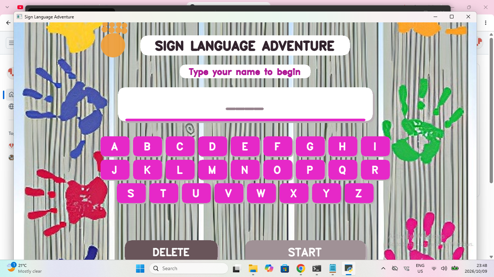
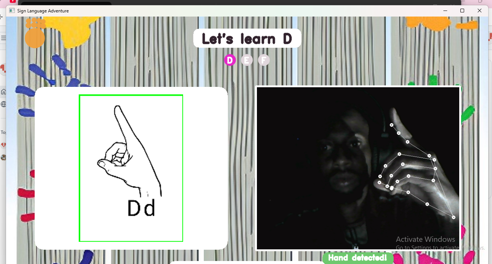
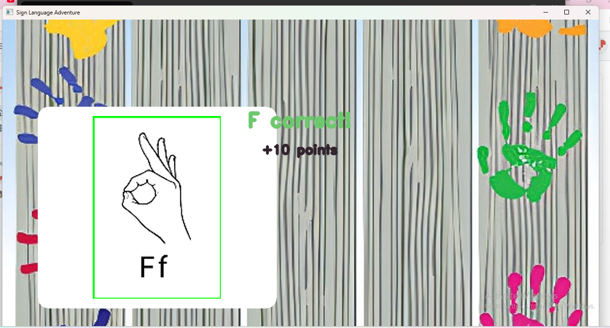
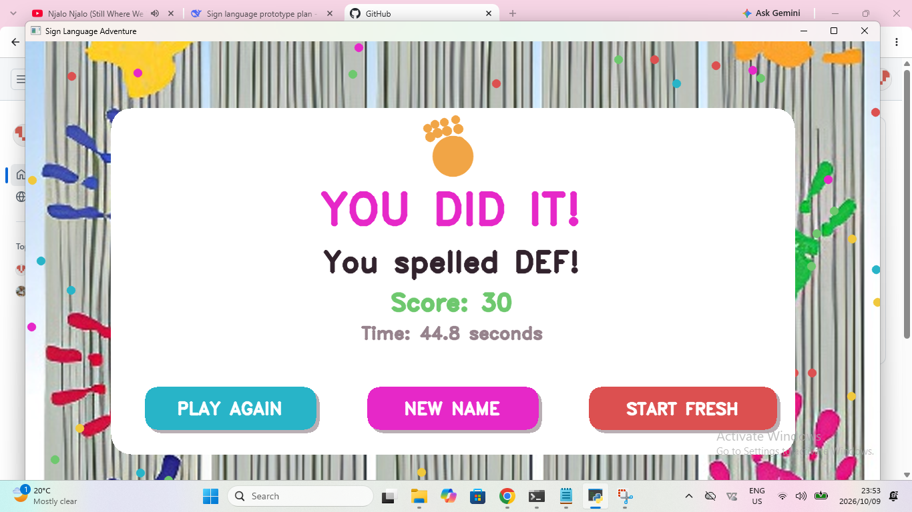

# Sign Language Adventure 🖐️

A gamified sign language learning prototype that teaches children to fingerspell their name.

The learner **teaches the AI their own hand shapes**, then the AI tests if they remember — so no prior sign language knowledge is needed, and recognition works for any hand size.

## Screenshots

### 1. Type your name


### 2. Teach the AI each letter


### 3. Spell your name from memory


### 4. Celebrate!


## How It Works

1. **Name entry** — child types their name on the on-screen keyboard
2. **Teach phase** — for each unique letter, the child makes the shape and presses SPACE. The app records 21 hand-landmark positions.
3. **Play phase** — the child must now reproduce each shape from memory.
   - Correct pose held for 1 second = +10 points (auto-advance)
   - Wrong guess = SPACE press, and points reduce per attempt
   - After 5 failed attempts, the answer is shown and the app moves on with 0 points
4. **Celebration** — score, time, and three buttons: Play Again / New Name / Start Fresh

## Tech Stack

- **Python 3.12**
- **MediaPipe** — real-time hand landmark detection (21 points per hand)
- **OpenCV** — camera capture and custom UI rendering
- **NumPy** — array operations for pose comparison

Recognition uses **normalized Euclidean distance** between the live hand pose and the taught reference, with a minimum margin against the runner-up letter.

## Running Locally

Requires Python 3.12 (64-bit) and a webcam.

```bash
pip install opencv-python mediapipe numpy
python game_kids.py